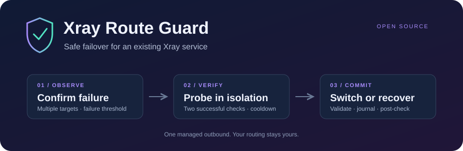

<p align="center"></p>

<p align="center">
  <a href="https://github.com/Evangelion91/xray-route-guard/actions/workflows/test.yml"></a>
  <a href="LICENSE"></a>
  <a href="https://github.com/Evangelion91/xray-route-guard/releases"></a>
</p>

Conservative failover for **an existing Xray service** on OpenWrt or Linux.
Keep your routing setup; replace one named outbound after a verified failure.

- **Check the route.** Consecutive failures, multiple HTTPS targets, cached subscriptions and cooldown.
- **Prove the replacement.** A separate loopback-only Xray process must pass two checks. Recovery of the current route cancels the switch.
- **Recover the configuration.** Validate, journal, replace, restart, verify. A failed check restores the previous file; interrupted transitions recover on restart.

This is an early public preview. The original Lua monitor was used on a GL.iNet router; this Go implementation has separate validation and is not yet a router-certified release. [Evidence and limits →](docs/validation.md)

## Install

Download the Linux archive for your router's CPU and `SHA256SUMS` from
[Releases](https://github.com/Evangelion91/xray-route-guard/releases).
Verify its checksum, extract it, then:

```sh
sh install.sh                         # OpenWrt; installs disabled
cp /etc/xray-route-guard/config.example.json /etc/xray-route-guard/config.json
chmod 600 /etc/xray-route-guard/config.json
# Edit the configuration and create a private subscription.url file.
xray-route-guard check
xray-route-guard refresh
/etc/init.d/xray-route-guard start
/etc/init.d/xray-route-guard enable
```

**Before starting:** an existing Xray service, a dedicated health SOCKS inbound,
an unconditional routing rule to the managed outbound, and an unused probe port
are required. Follow the [configuration guide](docs/configuration.md).
The installer does not flash firmware or configure Xray, DNS, firewall or LAN routing.

## Fits an existing setup

VLESS subscriptions: plain or base64, TCP/RAW, WS, gRPC and XHTTP with TLS/REALITY.
An array of standalone Xray outbound objects is the extension format for other
supported protocols. Unsupported links are skipped; an empty result keeps the
last valid cache. New configurations are checked by your installed Xray binary.

Current connections may break when your restart command runs. Keeping the old
configuration when all nodes fail is **not** a guarantee that traffic still works.
This tool does not install a kill switch: any direct routes already in your Xray
configuration remain your responsibility.

Already using PassWall2, Podkop or RouteFlux? Their built-in selection may be a
better fit. This project is for users who want to keep a separately managed Xray
service. [Comparison and scope →](docs/alternatives.md)

## Inspect and extend

```sh
xray-route-guard status
go test -race ./...
XRAY_BINARY=/path/to/xray go test ./internal/guard -run RealXray -v
sh scripts/release.sh v0.1.0
```

No third-party Go modules. `Driver` separates the decision loop from the Xray
backend; subscription decoding is independent of activation and recovery.
See [development](docs/development.md), [recovery](docs/recovery.md) and
[Русская инструкция](docs/ru.md).
